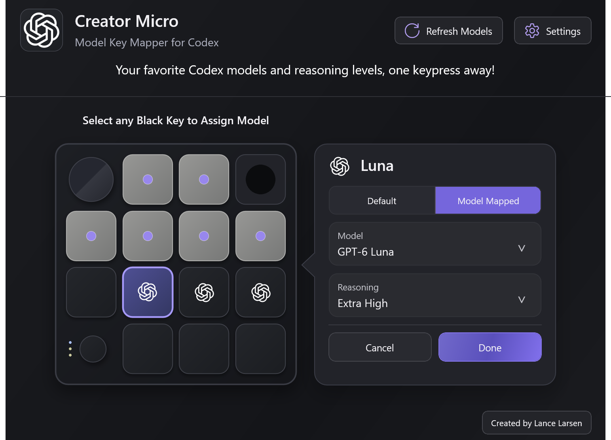
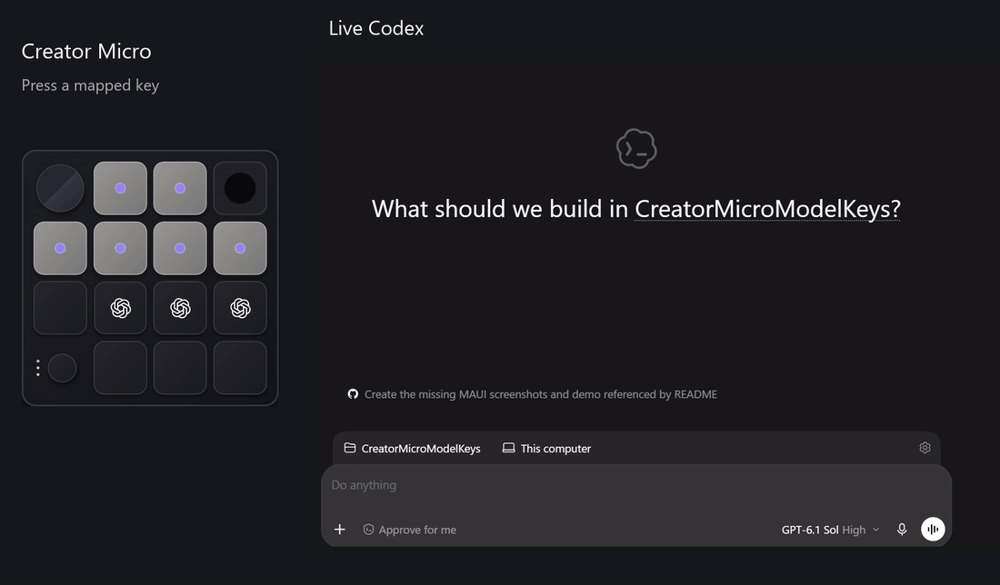
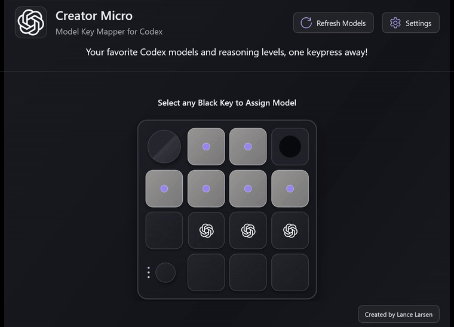
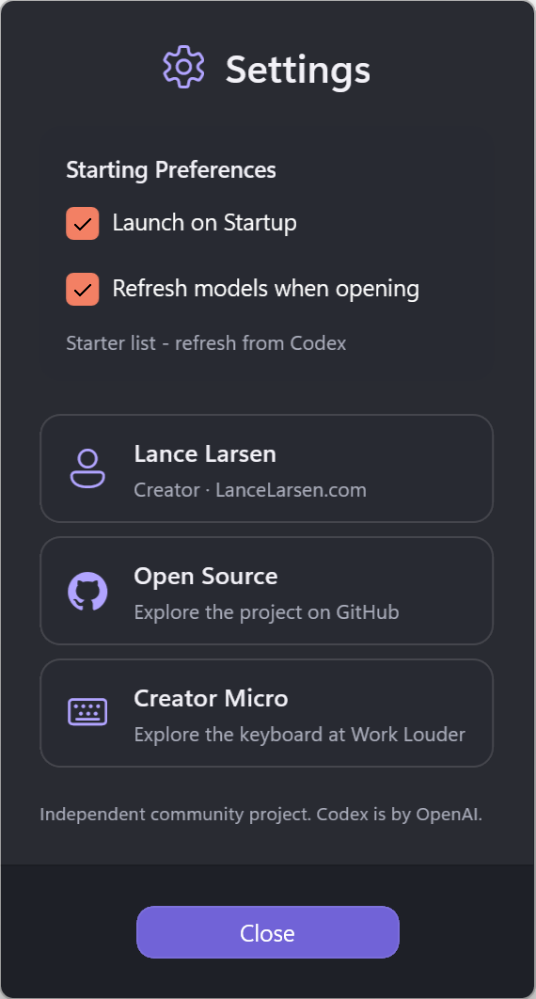
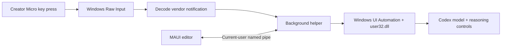

# Creator Micro — Model Key Mapper for Codex

**Your favorite Codex models and reasoning levels, one keypress away!**

> **Windows only, for now.** This app uses Windows device input, window management, and accessibility APIs. macOS and Linux are not currently supported.

Turn any of the seven lower keys on your [Work Louder Creator Micro](https://worklouder.cc/creator-micro-2) into a Codex model preset. Keep Luna with Extra High reasoning on one key, Sol with High on another, and Astra with Low on a third.

Built by [Lance Larsen](https://www.LanceLarsen.com). Independent community project; not affiliated with or endorsed by OpenAI or Work Louder.



## See it in action

### Switch models in Codex



[Watch or download the Codex preset demo](docs/media/codex-presets.mp4)

The key indicators appear before each preset trigger. Codex displays **Light** for the Astra **Low** preset.

### Configure your keys



[Watch or download the MP4 demo](docs/media/editor-demo.mp4)

## What you can do

- Assign a model and reasoning level to **any of the seven black keys**.
- Switch between **Default** and **Model Mapped** for each key.
- Keep the six colored Codex chat keys working.
- Read the models shown in your Codex account with **Refresh Models**.
- Run quietly in the Windows notification area and launch when you sign in.
- Open the editor with a click on its tray icon; closing the editor keeps the helper running.

Unmapped keys are blank in the diagram. Mapped keys display the Codex logo. The diagram does not attempt to copy the native action labels or icons you customize inside Codex.

## Requirements

| Requirement | Details |
| --- | --- |
| Operating system | Windows 10 or 11, x64 |
| Hardware | Creator Micro using the Codex input layer |
| Codex | The Windows desktop app, signed in, with its model controls available |
| Runtime | [.NET 10 Desktop Runtime](https://dotnet.microsoft.com/en-us/download/dotnet/10.0) for the background helper; the published editor includes its own runtime |
| Building from source | .NET 10 SDK and the MAUI Windows workload |

The original hardware setup uses **Input 4** for Codex. Input 1 sends ordinary letters and will not trigger these presets. Compatibility depends on the device exposing the vendor notifications used by Codex.

The current window detection targets the installed WindowsApps OpenAI Codex package. Other distributions and future Codex UI changes may require integration updates.

## Build and install

Open PowerShell on Windows:

```powershell
git clone https://github.com/lancelarsen/Creator-Micro-Model-Key-Mapper-for-Codex.git
cd Creator-Micro-Model-Key-Mapper-for-Codex
dotnet workload install maui-windows
.\scripts\Publish.ps1
.\scripts\Install.ps1
```

The installer:

- Places the helper and editor in `%LOCALAPPDATA%\CreatorMicroModelKeys`.
- Backs up an existing installation before replacing its files.
- Stops the previous listener to prevent duplicates.
- Enables startup for a new installation and preserves an existing startup opt-out.
- Opens the editor.

Keep the published **editor** subfolder beside **CodexMicroPresets.exe** if you run directly from the publish folder. The helper's executable name is retained for compatibility.

## Assign your keys

1. Open Codex and select the Micro's Codex input layer.
2. Click the mapper's tray icon.
3. Select a black key in the diagram.
4. Choose **Model Mapped**, then pick a model and reasoning level.
5. Click **Done**. The spinner shows when the helper is applying changes in Codex.
6. Bring Codex to the front and press that physical key.

**Done** saves and closes the panel after a successful operation. **Cancel** discards pending assignment changes and closes it. Closing the window with unsaved assignments asks whether to discard them.

Choose **Default** and click **Done** to restore the native Codex action previously backed up for that key.

### Initial assignments

The letters below are physical position references, not letters you need to type. They are hidden in the visual editor.

| Position | Initial assignment |
| --- | --- |
| H | GPT-6 Luna · Extra High |
| I | GPT-6.1 Sol · High |
| J | GPT-6 Astra · Low |
| G, K, L, M | Default native actions |

Available models depend on your Codex account. You can replace these presets at any time.

## Settings and model refresh



**Launch on Startup** and **Refresh models when opening** default to on for new installations. Changes to these preferences save immediately.

**Refresh Models** briefly opens Codex's model menu, reads its choices in display order, and updates the local cache. When finished, it returns focus to the mapper if Codex still owns focus. If you switch to another application during the refresh, the helper respects that choice.

If a refresh fails or returns fewer models than the saved catalog, the previous list is retained. Refresh discovers model names; it does not discover each model's supported reasoning levels or change your assignments automatically.

Right-click the tray icon to **Pause**, **Resume**, or **Exit**.

## How it works

The mapper responds to physical key presses, but it does **not** install a global keyboard hook or intercept ordinary typing. It subscribes to the Creator Micro's vendor HID reports and reacts only to enabled preset keys.



### 1. Listen for the hardware event

[MicroInputListener.cs](MicroInputListener.cs) creates a message-only Windows window and registers for the device's vendor HID usage page with `RegisterRawInputDevices` from **user32.dll**.

Windows delivers `WM_INPUT` messages. The listener uses `GetRawInputData` and `GetRawInputDeviceInfoW` to read reports and filter supported Micro devices. It subscribes read-only and does not take exclusive ownership of the keyboard.

[ReportDecoder.cs](ReportDecoder.cs) reassembles fragmented reports, decodes `v.oai.hid` notifications, and matches key-down events to enabled presets. Releases, held-key repeats, unrelated messages, and ordinary typed H/I/J letters do not trigger a model change.

### 2. Prevent the original action from firing alongside the preset

When you enable an override, [MicroBindings.cs](MicroBindings.cs) uses Codex's Creator Micro settings to back up the original keycap/action and change that key's action to **Focus main chat**. This prevents actions such as Send, New Chat, or dictation from also firing when you press a mapped key.

Switching back to Default restores the saved native action. The helper verifies the changes and attempts rollback on failure. The six colored chat keys and the dictation mode setting are left alone.

### 3. Operate Codex's visible controls

[ModelSelector.cs](ModelSelector.cs) locates the Codex window and uses **Windows UI Automation** through `System.Windows.Automation` to find the model menu, choose the requested model, and read the reasoning control.

When a control needs pointer input, the helper uses **user32.dll** functions including `GetCursorPos`, `SetCursorPos`, and `SendInput`. It verifies the control under the pointer before clicking and restores the pointer afterward. It also uses Windows key input to dismiss menus.

Window APIs such as `EnumWindows`, `GetForegroundWindow`, and `SetForegroundWindow` handle window discovery and focus. The editor grants foreground permission to the connected helper for refresh/save operations.

Finally, the helper reads the resulting composer label and checks that both the model and reasoning match. Unsupported reasoning levels produce an error rather than silently selecting a lower level.

**This is desktop UI automation.** It does not inject code or DLLs into Codex, patch Codex files, or call a model API. The visible model controls may briefly open while the preset is applied.

### 4. Keep settings and device work separate

The **.NET MAUI editor** handles the interface and unsaved drafts. The **background helper** owns the tray icon, hardware listener, Codex operations, and settings files.

They communicate over a named pipe restricted to the current Windows user and session. Operations are serialized, and preset presses are ignored during save/refresh work to avoid competing with configuration.

## Local data and privacy

Data stays in `%APPDATA%\CodexMicroPresets`:

| File | Purpose |
| --- | --- |
| `settings.json` | Your model assignments |
| `original-actions.json` | Backups used to restore native key actions |
| `models.json` | Cached model list and refresh preference |
| `runtime.jsonl` | Helper diagnostics |

The mapper sends no telemetry and does not log ordinary keyboard text or chat contents. Website buttons open your browser. Codex's own network activity is separate from this helper.

## Troubleshooting

| Symptom | What to check |
| --- | --- |
| A key types a letter | Select the Micro's Codex input layer rather than its ordinary keyboard layer. |
| Nothing happens on a preset press | Bring Codex to the front, confirm the tray helper is running, and confirm the key is Model Mapped. |
| Model refresh fails | Open a Codex chat with a model selector and retry. The existing cache is preserved. |
| A removed model remains listed | A smaller discovery result is currently treated as incomplete; the previous catalog is kept. |
| Requested reasoning is unavailable | Choose a level supported by that model. The helper checks the resulting Codex label. |
| Saving cannot restore a key | Ensure Codex's Creator Micro settings are accessible. Unsupported/custom layouts fail rather than guessing key positions. |
| It stops working after a Codex update | The integration depends on accessible labels and UI structure; an update to this project may be needed. |

To restore all overridden keys, keep Codex open and run:

```powershell
& "$env:LOCALAPPDATA\CreatorMicroModelKeys\CodexMicroPresets.exe" --restore-layout
```

Disable automatic startup in Settings, or run `scripts\Uninstall-Startup.ps1`. That script does not remove the application or your saved assignments.

## Development and media capture

```powershell
.\scripts\Publish.ps1
dotnet .\publish\CodexMicroPresets.dll --self-test
.\publish\editor\CreatorMicroEditor.exe --ui-check .\artifacts\ui
.\tools\CaptureReadmeMedia.ps1
```

The backend checks cover event decoding, mappings, catalog protection, and private-pipe communication. The UI check exercises all seven selections, draft toggles, dropdowns, transitions, and save-failure feedback, then captures native views.

Media capture uses an isolated editor with example assignments. It renders actual native frames and encodes a GIF and MP4 with **FFmpeg**, which must be installed and on PATH. It does not run live helper operations or save bindings.

`--verify-bindings` is a separate interactive integration check that temporarily changes and restores all seven lower keys in Codex; do not run it while using those keys.

## Contributing

Bug reports are most useful with your Windows version, Codex version, Micro input layer, and the exact action that failed. Please remove private information from any screenshots or diagnostic logs before sharing them.

Built with C#, .NET 10, .NET MAUI, WinForms, and Windows UI Automation.

## License and credits

Project code is [MIT licensed](LICENSE).

The Codex/OpenAI mark is an OpenAI brand asset and is not covered by this project's MIT license; see the [asset notice](Editor/Resources/Images/NOTICE.md). The GitHub mark is from [Primer Octicons](https://github.com/primer/octicons), with its [MIT license](assets/github-mark.LICENSE).

[Created by Lance Larsen](https://www.LanceLarsen.com) · [Creator Micro hardware](https://worklouder.cc/creator-micro-2) · [GitHub source](https://github.com/lancelarsen/Creator-Micro-Model-Key-Mapper-for-Codex)
